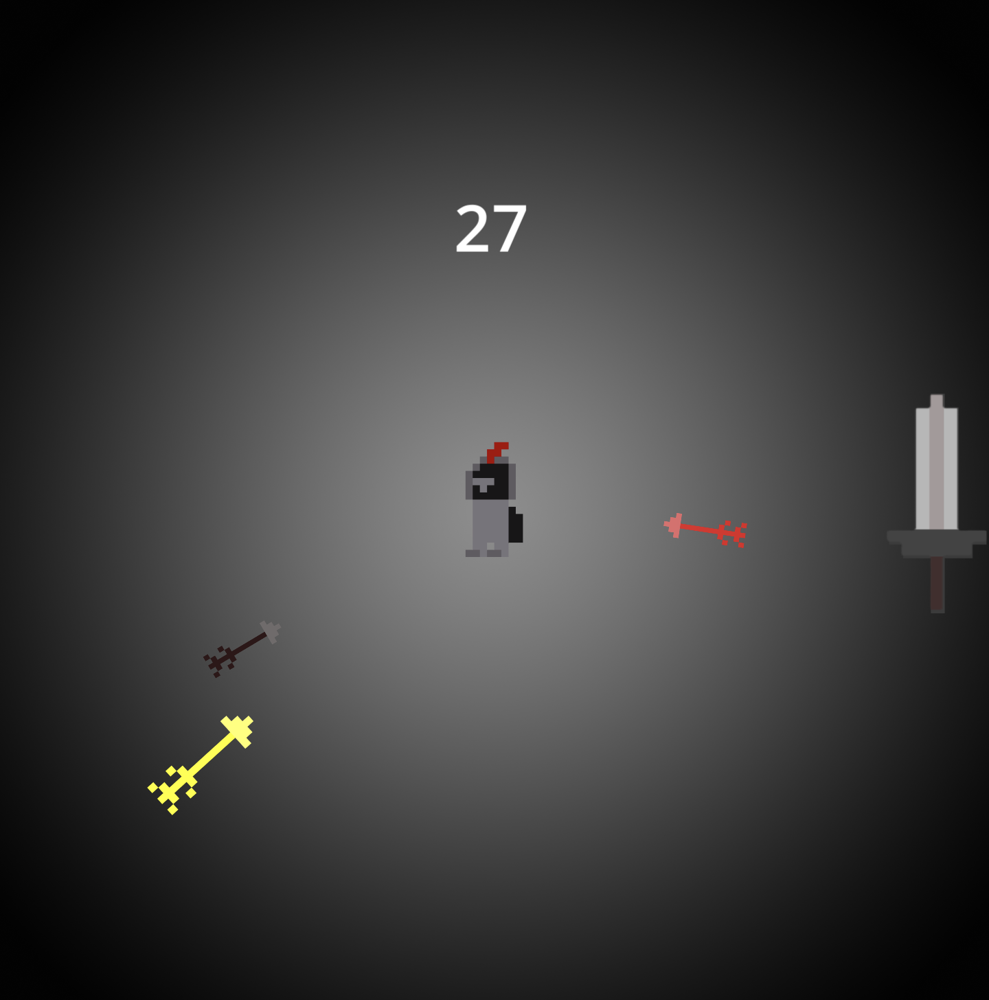

# Parry Sixte

A small survival game I made in Godot where you have to survive waves of arrows flying towards you.

The concept is pretty simple: you're stuck in an arena, and arrows keep coming at you from different directions. You have to defend yourself and survive for 60 seconds to beat each stage.

## Gameplay

The game starts off relatively easy, but the longer you survive, the more difficult it gets. Arrows start spawning faster, and new types appear as you progress.

Some arrows are faster than normal, some are much bigger or smaller, and others can turn invisible, making them harder to see coming.

There are two stages, each lasting 60 seconds, as well as an easy mode if you want something a bit less challenging.

## How I made it

I made the game using Godot and GDScript.

One of the main things I worked on was the arrow spawning system. Rather than just having arrows appear randomly at a constant rate, I made a timer-based system that changes the speed, size, and frequency of arrows depending on how long you've survived.

I also added visual warnings before certain waves, animations for when arrows get deflected, and a small hit-stop effect to make blocking arrows feel more satisfying.

## Challenges

The hardest part was getting the different arrow patterns and timings to work properly. I had quite a few bugs with the spawning system, especially when multiple arrows were on screen at once.

I also had to work on scene transitions, since occasionally the game would freeze when restarting after dying.

It was a good opportunity to get more familiar with Godot's scenes, signals, timers, and collision detection.

## Final thoughts

This was a fun project to make, and I learned quite a bit about how to structure a small game in Godot. I'm pretty happy with how the different arrow types turned out, especially the invisible ones.